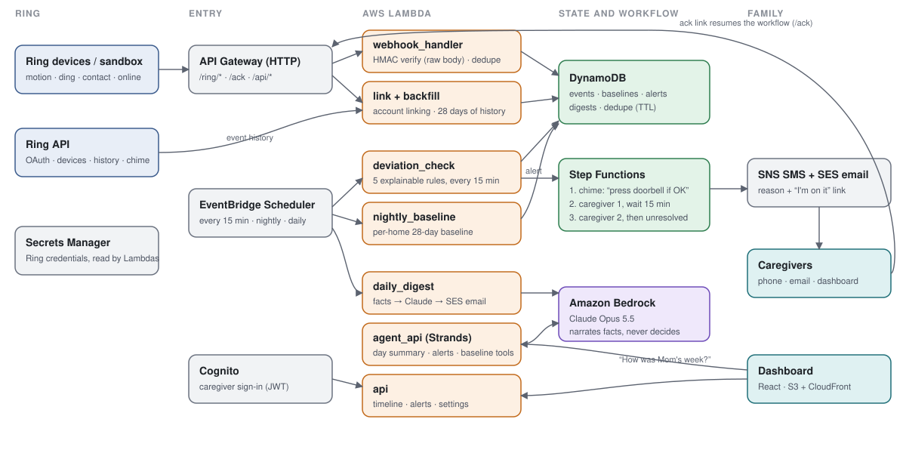

# Routine Guardian

Routine Guardian lets family know when an older relative's day at home stops looking like their normal day. It learns the household's rhythm from Ring events (motion, doorbell presses, door contact sensors) and alerts caregivers only on meaningful changes, each with a one-sentence reason. No video is analysed.

> "No activity yet today. Usually first active by 8:30 AM (9 of 10 days)."
> "The usual 10:00 AM visit didn't happen."
> "Front door opened at 2:14 AM, which is unusual for this home."

Built for the Amazon Developer Hackathon (Ring track, plus the AWS Builder and Open Source mini challenges).



## How it works

1. **Ring events in.** Ring webhooks (motion, doorbell, contact sensors, online/offline) arrive at API Gateway. Every request's HMAC signature is checked against the raw body before anything else, retries are deduplicated on Ring's `request_id`, and events are stored in DynamoDB. When a home links its Ring account, the last 28 days of event history are backfilled.
2. **A baseline per home.** Every night the home's normal rhythm is recomputed from the last 28 days, in its own time zone: when the first activity of the day usually happens (p10/p50/p90/p95), activity per hour for each weekday, recurring visits such as a weekday aide, and how often the door opens at night. With less than a week of data the home shows a "learning" badge and uses safe defaults.
3. **Plain rules, every 15 minutes.** Five explainable rules run against today's events: `missed_morning`, `missed_visit`, `night_door`, `unanswered_doorbell`, `device_offline`. Each produces a severity and a reason in plain English. One alert per rule per day.
4. **Escalation.** A Step Functions workflow can first play a chime prompt at home ("press your doorbell if you're OK"; a press within 10 minutes resolves it). It then texts and emails caregiver 1 with an acknowledgement link, waits 15 minutes, moves on to caregiver 2, and finally marks the alert unresolved. Opening the link shows a confirm button, so email link previews never acknowledge an alert by accident.
5. **Claude on Amazon Bedrock narrates, never decides.** A daily digest and a Strands agent ("How was Mom's week?") read only structured facts produced by the rules and baseline, and cite days and alerts. Whether to alert is always decided by the rules.
6. **Dashboard.** A React app on S3 + CloudFront with Cognito sign-in shows the day's timeline, activity against the usual pattern, alerts, the digest, an Ask box and settings.

## Privacy and safety

- Metadata only by default. No video analysis.
- Snapshots only during an active alert, only with explicit opt-in, and only as expiring links.
- A "vacation" toggle pauses monitoring.
- No medical claims: Routine Guardian reports that "a routine change was noticed", not health status.
- When a household unlinks the app in Ring, their data is deleted (the `app_integration_removed` webhook).

## Repository

| Path | What's there |
|---|---|
| `ring_routine_baseline/` | The reusable core, published as the [`ring-routine-baseline`](ring_routine_baseline/README.md) package: models, baseline, rules, explanations, Ring client, webhook verification, account linking |
| `lambdas/` | Webhook, deviation check, nightly baseline, backfill, account linking, escalation, acknowledgement, digest, dashboard API, agent API |
| `stepfunctions/escalation.asl.json` | Escalation workflow |
| `agent/` | Strands caregiver agent (Claude on Bedrock) |
| `infra/` | AWS CDK stack (Python) |
| `web/` | Vite + React dashboard |
| `simulator/` | Synthetic history generator, scenario YAMLs, signed webhook replay, false-alert evaluation |
| `tools/` | Local Ring dev server, AWS demo driver, dashboard demo-data export |
| `docs/` | [Deploy guide](docs/DEPLOY.md), [demo script](docs/DEMO_SCRIPT.md), [Devpost write-up](docs/DEVPOST.md), [product feedback](docs/PRODUCT_FEEDBACK.md), [friction log](docs/FRICTION_LOG.md) |

## Try it

```bash
python -m venv .venv && .venv/Scripts/activate     # macOS/Linux: source .venv/bin/activate
pip install -e ".[dev]" pyyaml strands-agents "anthropic[bedrock]"
pytest
python -m simulator.evaluate
```

`simulator.evaluate` replays each scenario through the rules every 15 minutes and counts false alerts over 28 normal synthetic days for 10 different seeds. Today it shows one false alert in 280 days, against a target of at most 1 per 28.

To see the dashboard without AWS, export the demo week and start the dev server, then open http://localhost:5173:

```bash
python -m tools.export_demo
npm --prefix web install
npm --prefix web run dev
```

To deploy to AWS and connect a Ring account, follow [docs/DEPLOY.md](docs/DEPLOY.md).

## Status

| Phase | State |
|---|---|
| 1. Core logic and simulator | Done. All scenarios trigger exactly their rule; 1 false alert in 280 normal days. |
| 2. Ring integration | Built and unit-tested against the documented API. Not yet run against the Ring sandbox. |
| 3. AWS pipeline | Built, `cdk synth` passes, end-to-end tested against mocked AWS (moto). Not yet deployed. |
| 4. Dashboard, digest, agent | Built and tested with a fake model. Dashboard verified in the browser on demo data. The live Bedrock answer still needs to be checked. |
| 5. Submission | README, demo script, Devpost write-up, product feedback, and the open-source package. |

## License

[MIT](LICENSE)
